<a href="https://vzuliani97.github.io">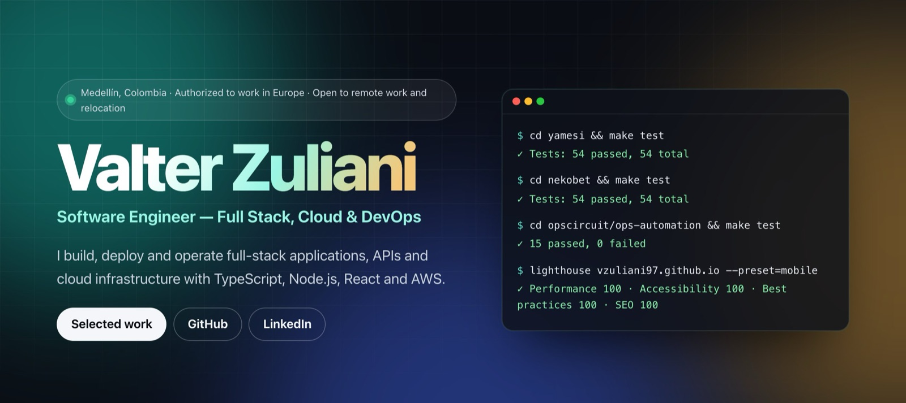</a>

  
  
  

# Hi, I'm Valter

**Software Engineer: Full Stack, Cloud & DevOps.** I build, deploy and operate full-stack applications, APIs and cloud infrastructure with TypeScript, Node.js, React and AWS.

Medellín, Colombia · Authorized to work in Europe · Open to remote work and relocation · Spanish and Italian native, English C1

| 123 | Since 2020 | 100 | C1 |
|:---:|:---:|:---:|:---:|
| automated tests across 3 portfolio systems (54 + 54 + 15) | professional software experience | mobile Lighthouse on 3 routes of my portfolio, measured 1 Nov 2026 | English, with native Spanish and Italian |

## Selected work

### Yamesi Core · Business Operations & Traceability System

<a href="https://vzuliani97.github.io/work/yamesi/">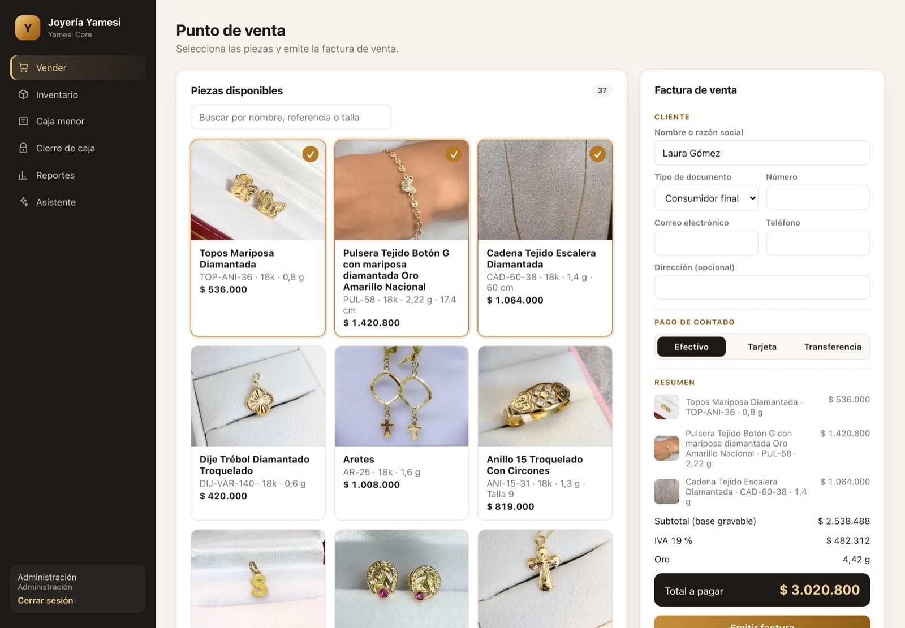</a>

**What it is for:** the counter of an 18k gold jewelry store. Find a piece by photo, reference or size; sell it with a Colombian-style invoice; keep the catalog and its photos current; record petty cash with receipts; and balance the drawer every night.

**What I built:**
- Data model in plain SQL: gold lots in milligrams, gap-free invoice numbers, VAT per line, closings and an audit log.
- NestJS API with roles, Zod validation, idempotent invoices, row and advisory locks, and a login lockout.
- React point of sale, an inventory portal with drag-and-drop photos, petty cash with receipts, closing and reports.
- Invoice PDF with each piece's photo, a CUFE calculation that matches the DIAN example and a QR. For demonstration only: not transmitted to or validated by the DIAN.
- Docker Compose, CI with CodeQL, Gitleaks and an image-metadata check, and a simulated business day (`make demo`).

`54 tests` · `44 real catalog pieces` · `CUFE = DIAN example` · `NestJS` · `React` · `PostgreSQL` · `S3` · `PDFKit` · `Docker`

<table>
  <tr>
    <td width="33%"><a href="https://github.com/vzuliani97/yamesi#processes-step-by-step">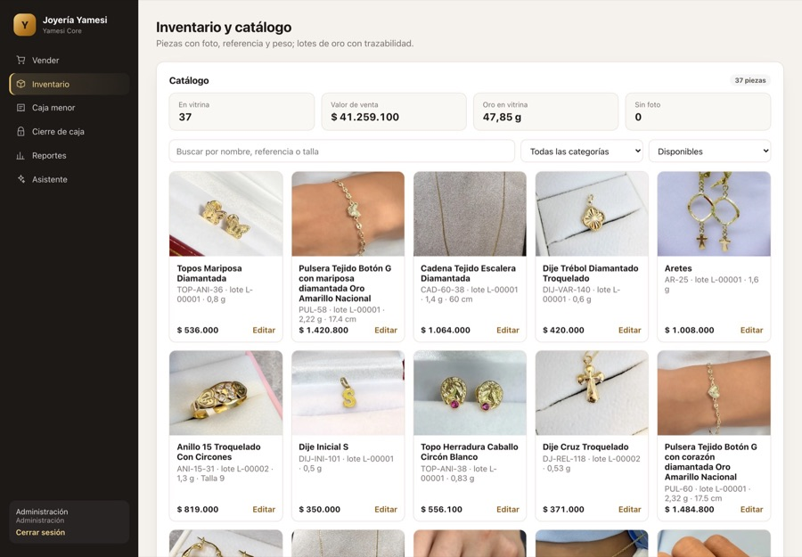</a> Inventory portal</td>
    <td width="33%"><a href="https://github.com/vzuliani97/yamesi#colombian-sales-invoice">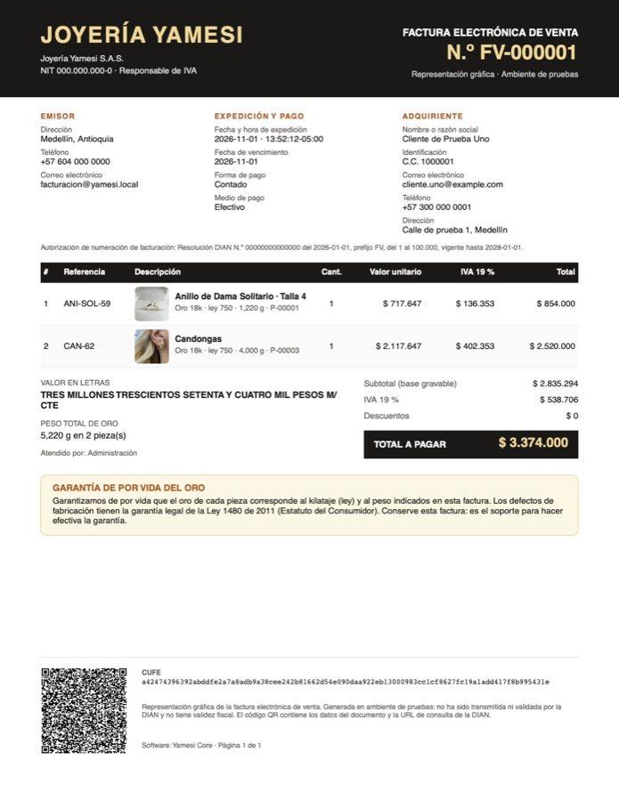</a> Invoice PDF with each piece's photo</td>
    <td width="33%"><a href="https://github.com/vzuliani97/yamesi#3-petty-cash-with-receipts">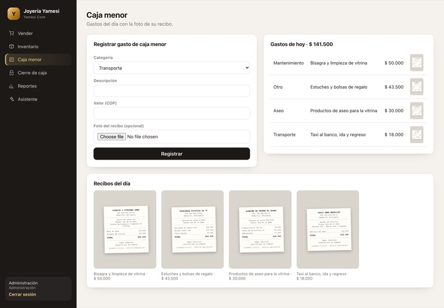</a> Petty cash with receipts</td>
  </tr>
</table>

Built for a real store: the demo runs on 44 pieces from the public catalog of Joyería Yamesi, with their real reference, gold weight, size, price and photo.

  
  
  
  
  
  

[Case study](https://vzuliani97.github.io/work/yamesi/) · [Source](https://github.com/vzuliani97/yamesi) · [Every process, step by step](https://github.com/vzuliani97/yamesi#processes-step-by-step) · [Design walkthrough](https://github.com/vzuliani97/yamesi/blob/main/DESIGN_WALKTHROUGH.md)

### OpsCircuit · Cloud Delivery & Incident Automation Lab

<a href="https://vzuliani97.github.io/work/opscircuit/">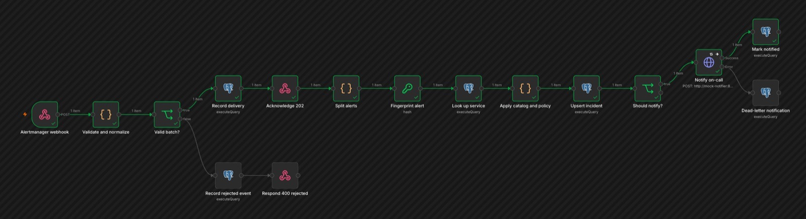</a>

**What it is for:** shows how a small team ships to Kubernetes, watches what is running, and turns a storm of alerts into one incident and one page, with drills that prove the recovery works.

**What I built:**
- A 3-node kind cluster with Kustomize overlays, Argo CD (GitOps), and Prometheus and Grafana provisioned as code.
- Hardened workloads: non-root containers, NetworkPolicies, Pod Security Admission; Checkov with zero failed checks.
- Outage and bad-release drills; found an alert that could never fire, fixed it and wrote the postmortem.
- n8n incident workflow: authenticated webhook, validation, deduplication in PostgreSQL, enrichment, bounded retries, dead letters and replay.
- Terraform for an AWS design (VPC, EKS, RDS, ECR), validated in CI and never applied.

`15 integration tests` · `self-heal in 2 s` · `5 deliveries → 1 page` · `Kubernetes` · `Argo CD` · `Prometheus` · `Grafana` · `Terraform` · `n8n`

<table>
  <tr>
    <td width="33%"><a href="https://github.com/vzuliani97/opscircuit#2-observe">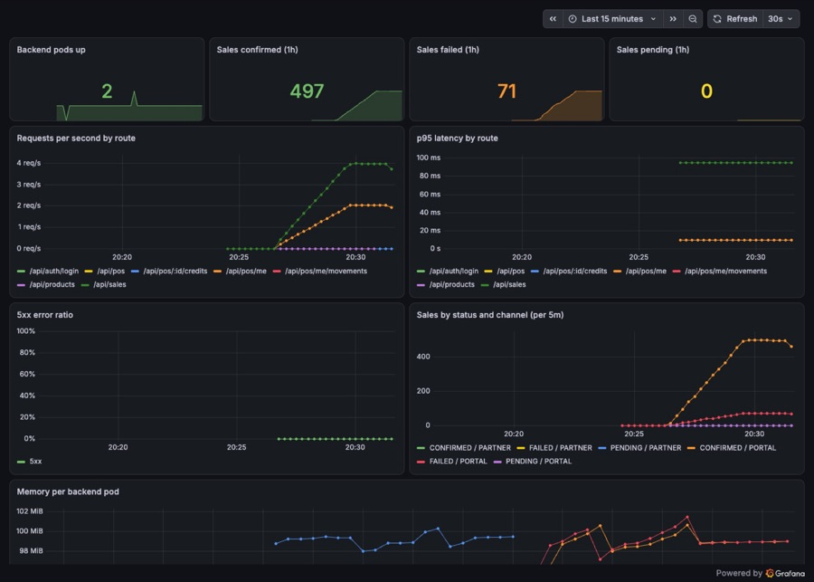</a> Grafana, provisioned as code</td>
    <td width="33%"><a href="https://github.com/vzuliani97/opscircuit#3-turn-alerts-into-one-incident-n8n">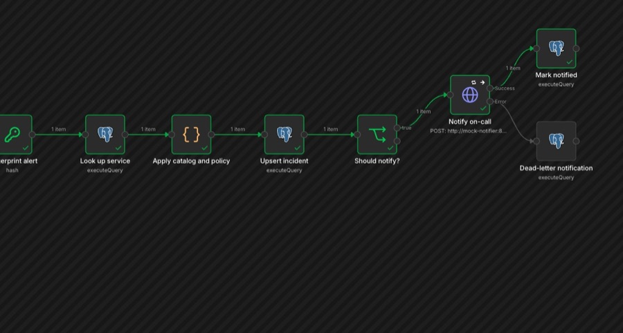</a> n8n: enrich, deduplicate and page</td>
    <td width="33%"><a href="https://github.com/vzuliani97/opscircuit#5-practice-the-bad-day">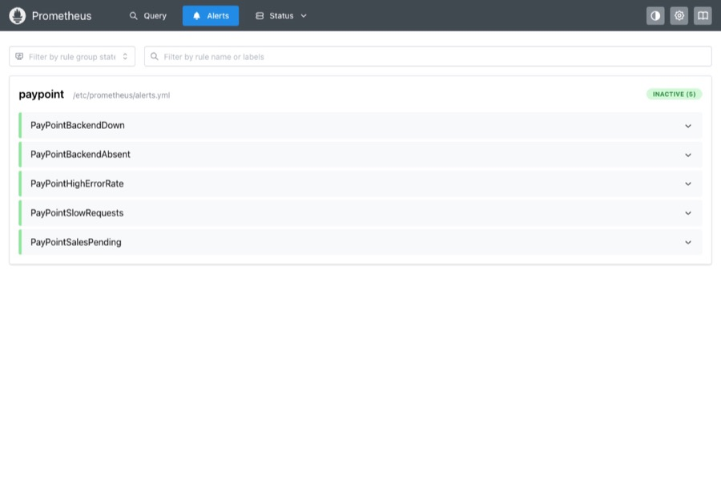</a> Prometheus alert rules</td>
  </tr>
</table>

[Case study](https://vzuliani97.github.io/work/opscircuit/) · [Source](https://github.com/vzuliani97/opscircuit) · [Every process, step by step](https://github.com/vzuliani97/opscircuit#processes-step-by-step) · [Incident lab verification](https://github.com/vzuliani97/opscircuit/blob/main/docs/INCIDENT_AUTOMATION_VERIFICATION.md) · [Postmortem](https://github.com/vzuliani97/opscircuit/blob/main/docs/incidents/2026-10-30-postmortem.md)

### NekoBet · Live Sportsbook, Casino & Wallet Platform

<a href="https://vzuliani97.github.io/work/nekobet/">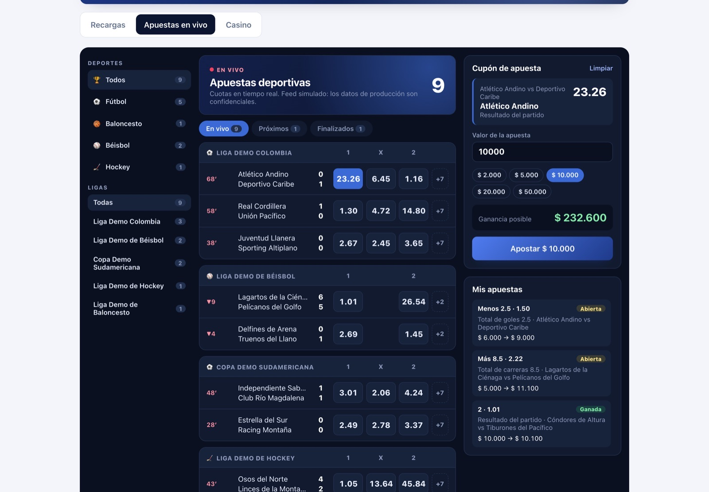</a>

**What it is for:** a point-of-sale network where every store sells live sports bets, casino games and prepaid top-ups from one balance, from a portal or a partner API. Everything runs in real time; the production betting platforms I worked on and their data are confidential, so this public version runs on a simulated feed. The engineering goal is a balance that never goes wrong.

**What I built:**
- A real-time sportsbook for football, basketball, baseball and ice hockey, each with its own clock and scoring model (Poisson goals and runs, a normal model of points, overtime and extra innings), results, double chance, totals and both teams to score, `ODDS_CHANGED` refusals and every market settled once.
- An event page with a live tracker drawn for each sport (pitch, court, diamond or rink) that flashes on every score.
- Casino: a seamless wallet with idempotent, HMAC-signed provider callbacks and rollback tombstones; a lobby of five games with an animated slot machine.
- Balance and ledger: one conditional `UPDATE`, `CHECK` constraints and append-only movements; idempotent sales; an HMAC-signed B2B API; a login lockout; CI images that Argo CD deploys in OpsCircuit.

`54 tests` · `4 sports live` · `70 retries → 1 sale` · `NestJS` · `PostgreSQL` · `React` · `SSE` · `HMAC` · `Docker`

<table>
  <tr>
    <td width="33%"><a href="https://github.com/vzuliani97/nekobet#2-place-a-live-bet">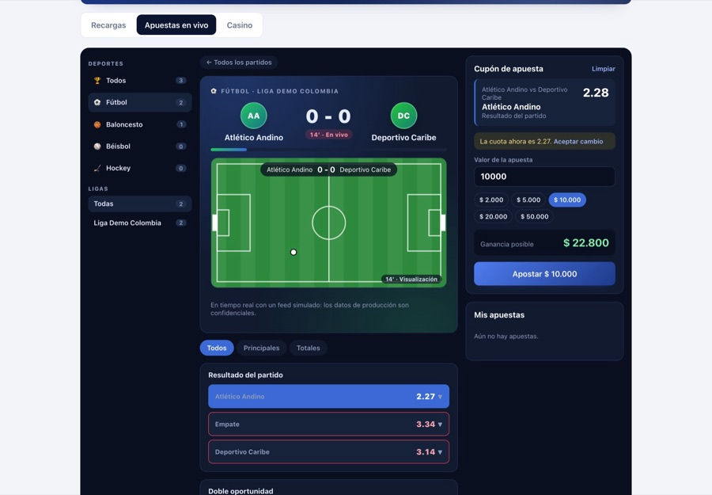</a> Football: live tracker and markets</td>
    <td width="33%"><a href="https://github.com/vzuliani97/nekobet#2-place-a-live-bet">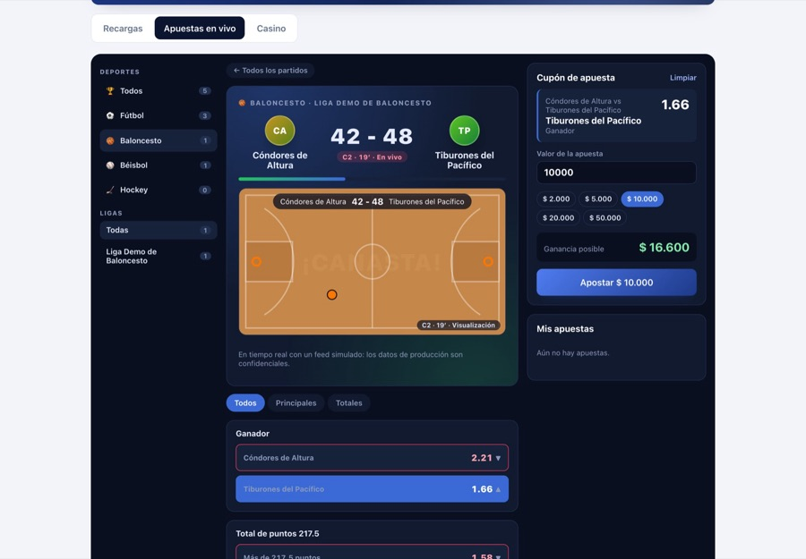</a> Basketball: court tracker by quarter</td>
    <td width="33%"><a href="https://github.com/vzuliani97/nekobet#3-play-the-casino-seamless-wallet">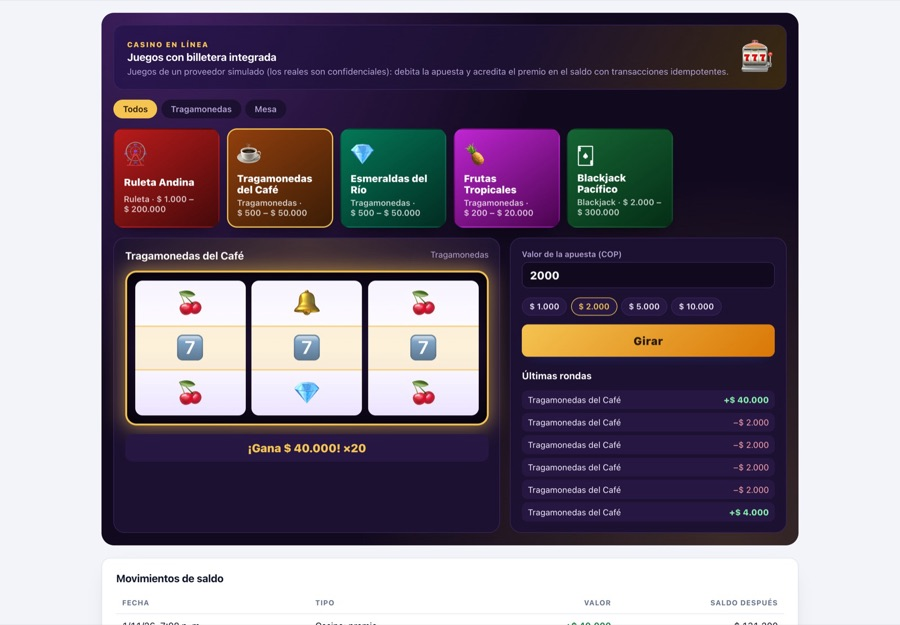</a> Casino: slot machine paying ×20</td>
  </tr>
</table>

[Case study](https://vzuliani97.github.io/work/nekobet/) · [Source](https://github.com/vzuliani97/nekobet) · [Every process, step by step](https://github.com/vzuliani97/nekobet#processes-step-by-step) · [Concurrency experiment](https://github.com/vzuliani97/nekobet/blob/main/docs/concurrency-experiment.md) (local and reproducible, not a production benchmark) · [Design walkthrough](https://github.com/vzuliani97/nekobet/blob/main/DESIGN_WALKTHROUGH.md)

## What I have worked on

**Full Stack Developer · Inversiones Zuliani S.A.S. (Yamesi)** · Medellín · May 2020 – Present
- Proposed and built the store's accounting and invoicing system, replacing spreadsheets and paper receipts; the business uses it for around 15 invoices a day.
- Deployed it with Docker on AWS EC2, with documents and images in S3, HTTPS, and network access controlled through security groups, SSH and VPN. Since 2023, as a contractor, I support, fix, test and update it.

**Junior DevOps Engineer · The Big Group** · Sydney · Oct 2024 – Mar 2026 · part-time
- Supported deployment and maintenance of AWS services for payments, digital operations and hospitality in an English-speaking international team, with CI/CD pipelines, Docker and Kubernetes.
- Investigated production incidents through logs and monitoring, and applied access controls to cloud resources.

**Software Developer (Full Stack / Cloud) · Código Digital Codi S.A.S.** · Medellín · Oct 2021 – Feb 2023
- Developed full-stack modules and Node.js APIs for transactional platforms, white-label iGaming platforms for several countries and healthcare applications with Angular, React, TypeScript, PHP and MySQL; built a B2B API secured with key pairs and IP allowlisting; and managed AWS infrastructure and deployments from staging to production with EC2, VPC, VPN, EKS, Terraform, Docker and GitLab CI/CD.
- Worked on the real-time sports betting and casino integration of the point-of-sale portal: the live-odds frontend, the provider integration, the betting backend (bet validation, balance and settlement) and its infrastructure.

**Software Developer · LaCompay Colombia** · Medellín · Nov 2020 – Apr 2021
- Contributed to the development of features for a C++ payment gateway, focused on transaction processing.

## Stack

**Software**

**Cloud & delivery**

**Working knowledge from the portfolio**

## Education

Systems Engineer, Universidad de Medellín · Advanced Diploma of IT (Cyber Security), Sydney

Portfolio projects are independent reconstructions with no employer code. Their data is synthetic (production systems are confidential), except the Yamesi Core demo catalog (© Inversiones Zuliani S.A.S., used with permission). AI-assisted; verified through tests and CI.
